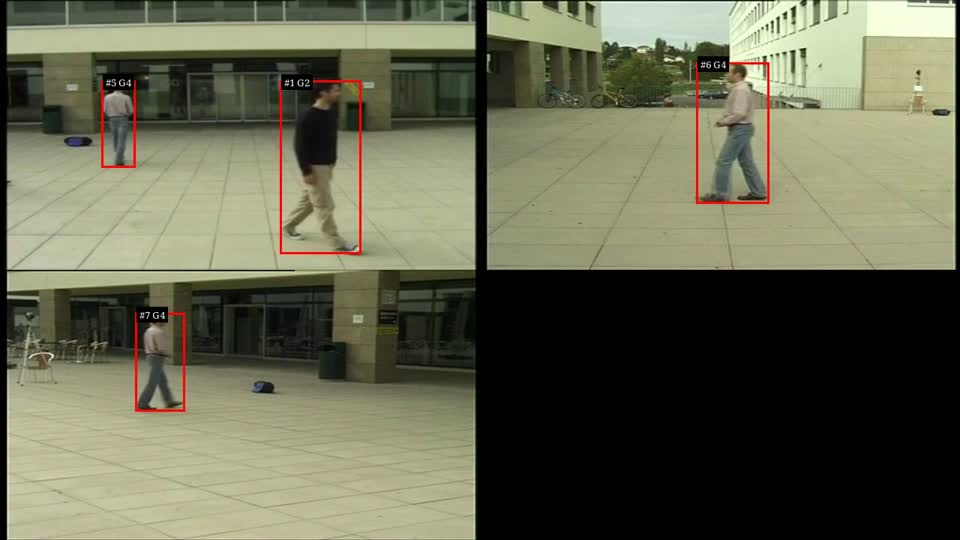
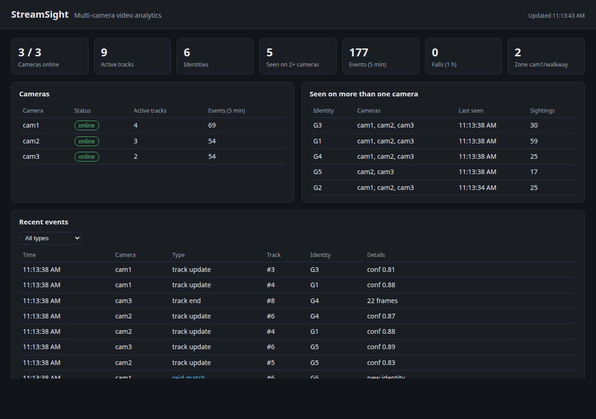

# StreamSight

Real-time multi-camera video analytics on NVIDIA GPUs: person detection, multi-object
tracking, **cross-camera re-identification**, pose-based fall detection and zone analytics,
with an event API, a live dashboard and Prometheus/Grafana monitoring.

Two interchangeable pipelines share the same tracking-to-events logic:

* **Python pipeline**: OpenCV capture, batched YOLO11 inference through ONNX Runtime
  (TensorRT, CUDA or CPU) or OpenVINO, ByteTrack, OSNet re-id. Easy to change and debug.
* **DeepStream pipeline**: NVDEC decode, `nvinfer` TensorRT FP16 with a custom C++ YOLO11
  parser, NvDCF tracker and an OSNet secondary model, with all frame data in GPU memory.
  This is the throughput path.



*Three views of the EPFL campus sequence. The person in the white shirt has the same
global identity (G4) in all three cameras.*

## Results

Measured on one machine: RTX 5090 (32 GB), Intel Core Ultra 9 285K, DeepStream 8.0,
TensorRT 10.13, ONNX Runtime 1.32. Three cameras from the EPFL campus sequence
(360x288, 25 FPS), YOLO11n at 640x640, OSNet x0.25 re-id.

| Pipeline | What runs | Throughput |
|---|---|---|
| Python, live pacing | decode, detect (TensorRT FP16), track, re-id, events, 3 cameras | real time: 24.8 FPS per camera (source-limited), detector 1.3 ms p50 per batch |
| DeepStream, max speed | decode, detect (FP16), NvDCF track, OSNet re-id, Python probe, events, 3 cameras | **1,955 FPS total** (652 FPS per camera) |

Detector backends (forward pass only, `streamsight-bench`):

| Backend | Batch | p50 latency (ms) | p95 latency (ms) | Throughput (img/s) |
|---|---:|---:|---:|---:|
| ort-cpu | 1 | 11.25 | 14.13 | 87 |
| ort-cpu | 4 | 37.97 | 45.86 | 103 |
| ort-cpu | 8 | 86.25 | 120.49 | 87 |
| ort-cuda | 1 | 2.10 | 2.18 | 475 |
| ort-cuda | 4 | 4.20 | 4.44 | 947 |
| ort-cuda | 8 | 7.79 | 8.03 | 1022 |
| ort-tensorrt | 1 | 1.11 | 1.18 | 891 |
| ort-tensorrt | 4 | 2.78 | 2.99 | 1438 |
| ort-tensorrt | 8 | 5.26 | 5.37 | 1518 |
| openvino-cpu | 1 | 11.59 | 13.01 | 87 |
| openvino-cpu | 4 | 38.70 | 48.39 | 100 |
| openvino-cpu | 8 | 76.11 | 81.33 | 104 |
| trtexec-fp32 | 1 | 0.72 | 0.91 | 1361 |
| trtexec-fp32 | 4 | 1.33 | 1.68 | 2893 |
| trtexec-fp32 | 8 | 2.00 | 2.40 | 3917 |
| trtexec-fp16 | 1 | 0.39 | 0.40 | 2530 |
| trtexec-fp16 | 4 | 0.61 | 0.61 | 6570 |
| trtexec-fp16 | 8 | 0.93 | 0.94 | 8609 |

ONNX Runtime and OpenVINO times are wall-clock per `session.run` from Python, including host-to-device copies. `trtexec` times are GPU compute only (CUDA graphs, no copies), which is the ceiling the DeepStream pipeline works towards since its frames never leave GPU memory.

Reproduce with `make bench`. Raw results are in `benchmarks/results/`.

## Dashboard



## Features

* Batched inference over the newest frame of every camera; stale frames are dropped, not queued
* Backends: ONNX Runtime (TensorRT EP with cached engines, CUDA, CPU), OpenVINO (CPU/iGPU/NPU), DeepStream/TensorRT
* ByteTrack-style tracker (two-stage association with low-confidence boxes, Kalman motion model)
* Cross-camera identities: OSNet embeddings, EMA-smoothed per track, matched against a gallery in Milvus (or in memory)
* YOLO11-pose keypoints, torso-angle fall detection, polygon zones with enter/exit events and occupancy
* Event API (FastAPI, PostgreSQL or SQLite): cameras, events, identities, per-identity timeline, summary
* Live dashboard served by the API
* Prometheus metrics (FPS, stage latency histograms, active tracks, re-id decisions, dropped events) and a provisioned Grafana dashboard
* Docker images for the API, the Python pipeline and the DeepStream pipeline; docker-compose stack with an RTSP camera simulator; Kubernetes manifests
* CI: lint, tests on Python 3.11/3.12, Docker build

## Quick start (local, no Docker)

Requires an NVIDIA driver for GPU inference; everything also runs on CPU (`device: cpu`).

```bash
make install        # venv + package with GPU, API and dev extras
make models         # YOLO11n, YOLO11n-pose -> ONNX; OSNet re-id model
make samples        # EPFL campus videos, converted to H.264
```

```bash
make api            # API + dashboard on http://localhost:8000
```

```bash
make run            # Python pipeline on the three sample cameras
```

Open <http://localhost:8000> for the dashboard and <http://localhost:9100> for raw metrics.
Annotated video per camera: `streamsight-pipeline -c configs/pipeline.yaml --save-dir output/`.

### DeepStream

Requires DeepStream 7.1+ (tested on 8.0) and the `pyds` wheel for your Python version.

```bash
make parser engines   # C++ bbox parser + TensorRT engines (trtexec)
streamsight-deepstream -c configs/pipeline.yaml --output output/tiled.mp4
```

Without `--output`, frames go to a fakesink at full speed (benchmark mode); `--sync` plays files in real time.

## Docker

```bash
docker compose up -d                       # API, Postgres, Milvus, RTSP simulator, Prometheus, Grafana
docker compose --profile gpu up -d         # + Python pipeline
docker compose --profile deepstream up -d  # or the DeepStream pipeline
```

The `camera-sim` service loops the sample videos into MediaMTX as `rtsp://mediamtx:8554/cam1..3`,
so the stack behaves as if it were connected to real cameras. Dashboard on `:8000`, Grafana on `:3000`.

Kubernetes manifests are in `deploy/k8s` (`kubectl apply -k deploy/k8s` after creating
`deploy/k8s/secrets.env` from the example). The pipeline deployment requests one `nvidia.com/gpu`.

## API

| Method | Path | Description |
|---|---|---|
| POST | `/api/v1/events/batch` | ingest events from pipelines (`X-API-Key` if `STREAMSIGHT_API_KEY` is set) |
| GET | `/api/v1/cameras` | cameras with online status, active tracks, recent event count |
| GET | `/api/v1/events` | filter by `camera_id`, `event_type`, `global_id`, `since` |
| GET | `/api/v1/identities?min_cameras=2` | people seen on several cameras |
| GET | `/api/v1/identities/{id}/timeline` | where and when one identity was seen |
| GET | `/api/v1/stats/summary` | counts, zone occupancy, falls in the last hour |
| GET | `/healthz`, `/metrics` | health check, Prometheus metrics |

Interactive docs at `/docs`.

## Configuration

One YAML file describes a deployment: cameras (with optional zones), detector backend and
thresholds, tracker, re-id gallery, event sink and metrics port. See
[`configs/pipeline.yaml`](configs/pipeline.yaml) for local files and
[`configs/pipeline.rtsp.yaml`](configs/pipeline.rtsp.yaml) for RTSP + Milvus.

To use keypoints and fall detection, switch the detector to the pose model:

```yaml
detector:
  model: models/yolo11n-pose.onnx
  task: pose
```

## Project layout

```
src/streamsight/
  detection/    letterbox, YOLO decode + NMS, ONNX Runtime and OpenVINO backends
  tracking/     Kalman filter, ByteTrack-style tracker
  reid/         OSNet embedder, in-memory and Milvus galleries, cross-camera matcher
  analytics.py  zones, torso angle, fall detection
  pipeline/     sources, scene logic, event publisher, metrics, overlay, runner, CLI
  deepstream/   GStreamer/DeepStream app with metadata probe
  api/          FastAPI app, SQLAlchemy models, queries, dashboard
  bench.py      backend benchmark
deepstream/     nvinfer configs, NvDCF tracker config, C++ YOLO11 parser
scripts/        model export, sample download, TensorRT engine build
docker/, deploy/, monitoring/
tests/
```

Design notes: [docs/architecture.md](docs/architecture.md).

## Limitations and next steps

* Re-id accuracy is not yet measured against ground truth. The plan is to evaluate on a multi-camera benchmark (identity F1 / IDF1) and tune `match_threshold` from that, instead of by eye.
* INT8 TensorRT engines need a calibration set; only FP16 and FP32 are wired up.
* Galleries grow without bound. Old embeddings should expire by age.
* Edge targets (Jetson, Intel NPU) are supported by the backends but not benchmarked here.

## Data and models

* Sample videos: EPFL CVLab multi-camera pedestrian dataset ("campus" sequence), used for research and demonstration. Downloaded by `scripts/download_samples.py`, not redistributed.
* YOLO11 by Ultralytics (AGPL-3.0); exported locally by `scripts/export_models.py`.
* OSNet x0.25 trained on MSMT17 (Zhou et al., *Omni-Scale Feature Learning for Person Re-Identification*, ICCV 2019), ONNX export from the `kornia/osnet` Hugging Face repository.

## License

MIT for this repository's code. Model weights keep their own licenses.
