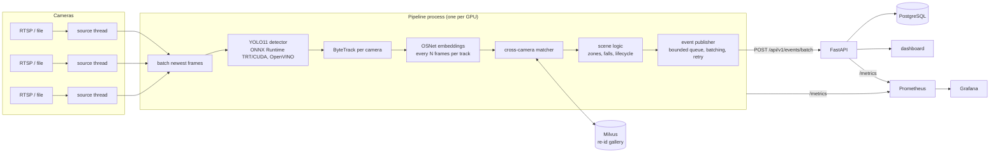

# Architecture

## Components

The DeepStream variant replaces everything from the source threads to the embeddings
with one GStreamer graph (`nvurisrcbin -> nvstreammux -> nvinfer -> nvtracker -> nvinfer`)
and feeds the same `CameraScene` from a pad probe. From the matcher onwards both
pipelines run identical code, so they produce the same events.

## Decisions

**Newest frame only.** Each camera is read on its own thread that overwrites a single
slot. If inference falls behind, old frames are skipped rather than queued, so latency
stays bounded and the system degrades to a lower frame rate instead of growing delay.

**One batch across cameras.** The newest frame of every camera goes through the detector
together. On a GPU, batch 3 costs little more than batch 1, so adding cameras is cheap
until the batch saturates the GPU.

**TensorRT optimisation profile.** The ONNX models have a dynamic batch axis. Without an
explicit profile, ONNX Runtime's TensorRT provider builds a new engine for every batch size
it encounters, which can block the pipeline for minutes when the number of ready cameras
changes. One profile (min 1, opt 4, max 16) covers every case with a single cached engine.

**ByteTrack association.** Low-confidence detections are matched against existing tracks
in a second pass instead of being thrown away. People who are partly occluded or blurred
keep their track id instead of getting a new one.

**Identity matching rules.** A track is only matched after `min_track_frames` so its
embedding is averaged over several crops (exponential moving average). Identities that
are currently visible in the same camera are excluded from the search, since one person
cannot be two tracks in one view at once. Embeddings are added to the gallery periodically
during a track's life, so each identity is stored from several angles.

**Milvus for the gallery.** An in-memory gallery is enough for one process. Milvus lets
several pipeline processes (one per GPU or site) share identities, survives restarts, and
keeps search time flat as the number of stored embeddings grows. The same class works with
Milvus Lite (a local file) for development.

**Events, not frames, leave the pipeline.** Only state changes are published (track
start/end, identity decisions, zone enter/exit, falls) plus a throttled position update.
That keeps API load proportional to activity, not to frame rate times camera count. The
publisher's queue is bounded: if the API is unreachable for long enough, the oldest
events are dropped and counted, so video processing never blocks on the network.

**Engines built offline for DeepStream.** `scripts/build_engines.sh` builds the TensorRT
engines with `trtexec` before deployment. Containers then start in seconds instead of
compiling engines at boot. The file names follow nvinfer's convention, so the configs
pick them up directly.

## Event types

| Event | When |
|---|---|
| `track_start` | a track is confirmed (after `min_hits` frames) |
| `reid_match` | the track receives a global identity; `attributes.matched` says whether it was linked to someone already seen |
| `track_update` | throttled position update, every `update_interval_s` |
| `zone_enter` / `zone_exit` | the foot point (bottom centre of the box) crosses a zone polygon |
| `fall_suspected` | pose model only: torso near horizontal for `min_frames` frames and the box is wider than tall |
| `track_end` | the track was lost for longer than the tracker buffer |
